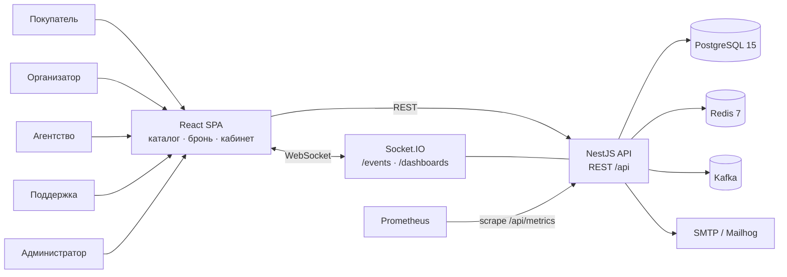
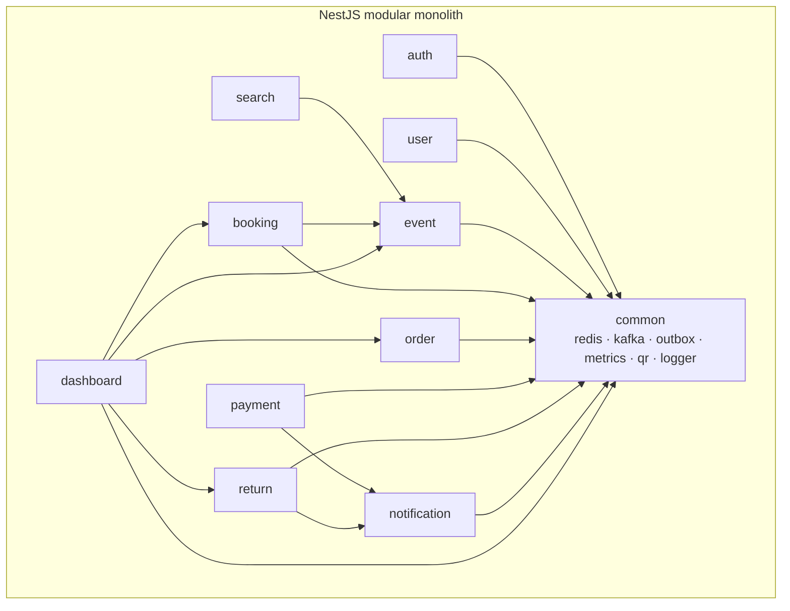
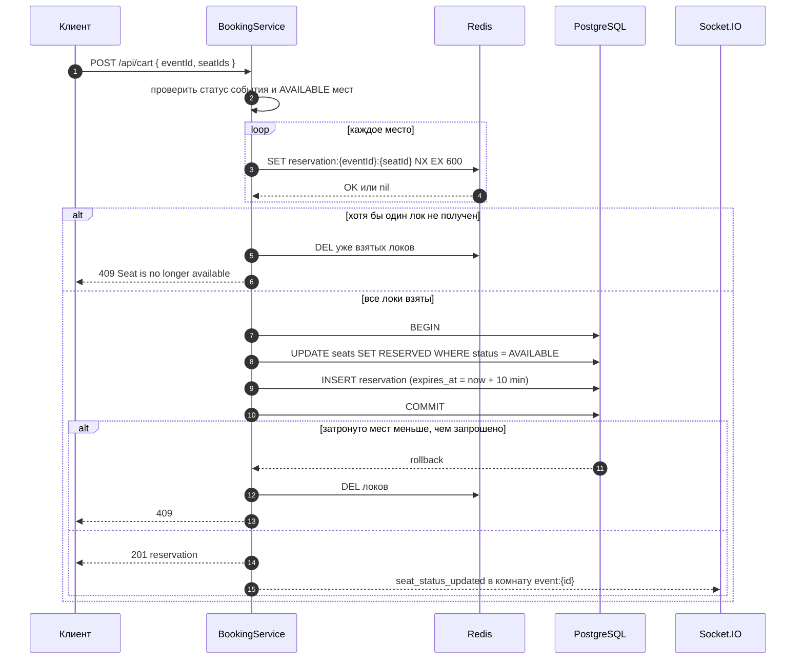
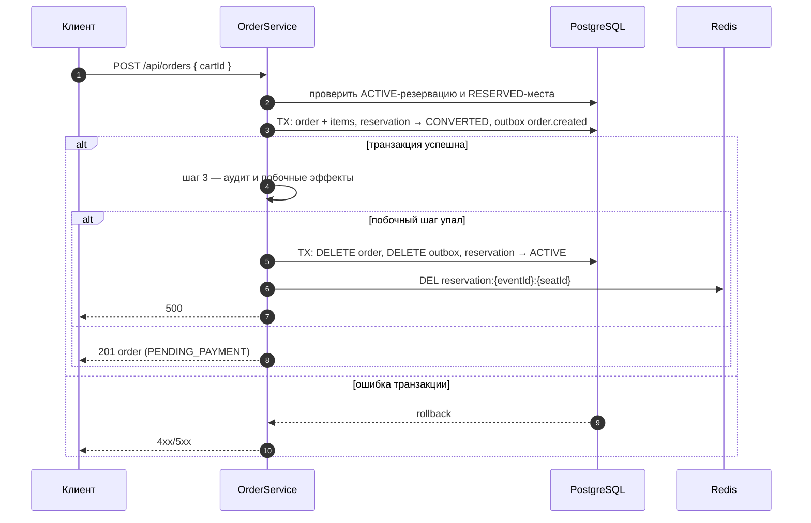
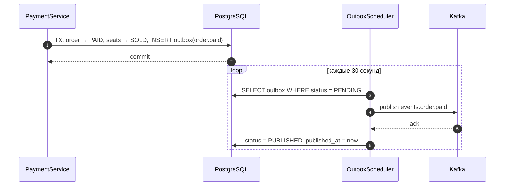
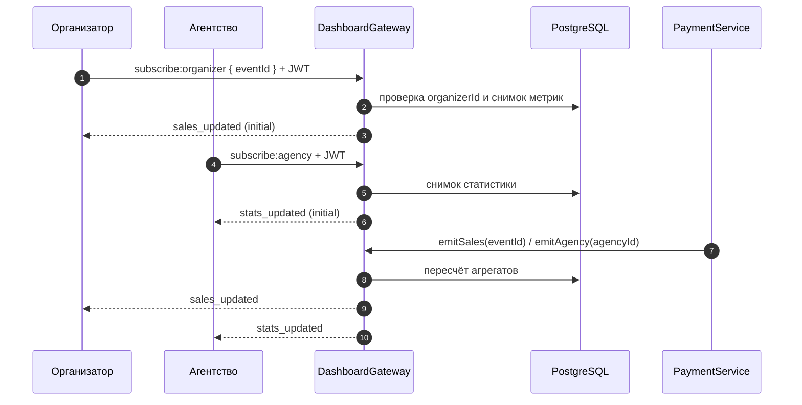
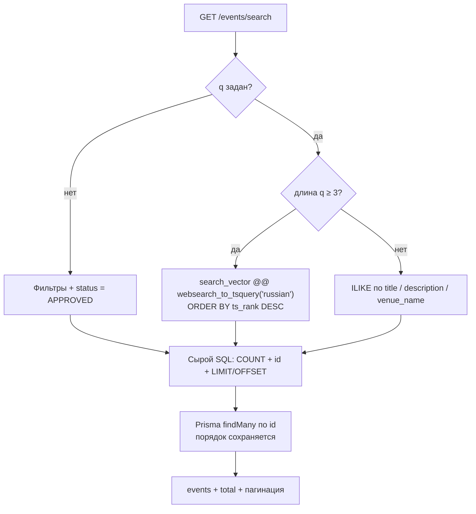
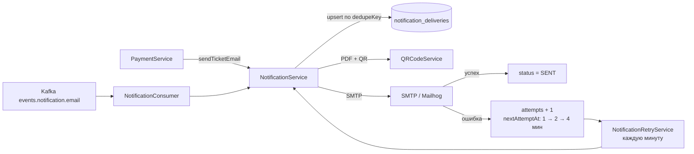
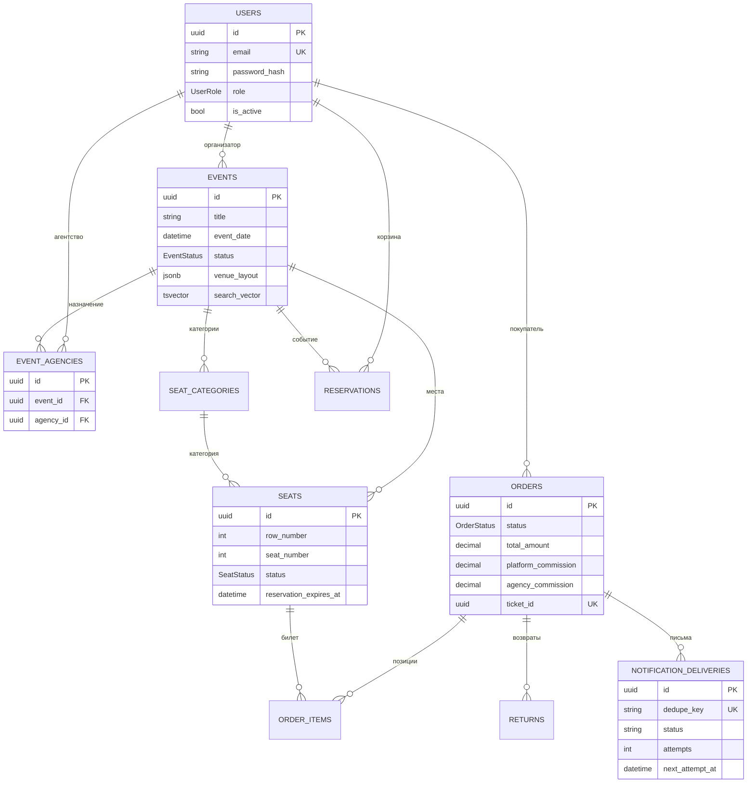
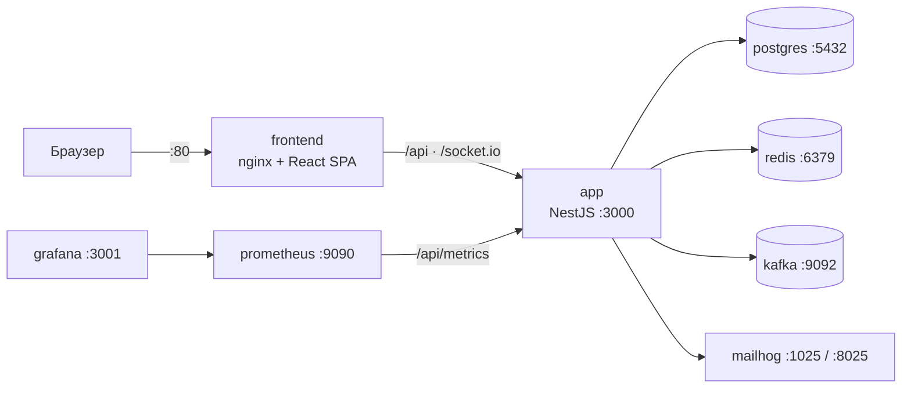

# Ticket Platform — описание проекта

Документ описывает цель, стек, архитектурные решения, компоненты и результаты нагрузочных
тестов. Диаграммы — Mermaid: GitHub отображает их нативно, в VS Code нужен плагин
Markdown Preview Mermaid Support либо предпросмотр GitHub.

---

## 1. Цель проекта

**Ticket Platform** — онлайн-платформа продажи билетов на мероприятия: каталог и поиск событий,
интерактивная схема зала, бронирование мест с таймаутом, оплата, возвраты и панели управления для
организаторов, агентств, поддержки и администраторов.

### Роли

| Роль | Основные возможности |
|---|---|
| **BUYER** | каталог, поиск, выбор мест, бронь на 10 минут, оплата, возврат, история заказов, PDF-билет |
| **ORGANIZER** | CRUD своих событий, схемы залов и категории мест, назначение агентств, модерация возвратов, статистика |
| **AGENCY** | назначенные события, продажа мест с комиссией, статистика продаж |
| **SUPPORT** | поиск заказов, ручная отмена/подтверждение, возвраты, история действий |
| **ADMIN** | модерация событий, пользователи и роли, комиссия платформы, глобальная аналитика |

### Ключевые требования

- **Никаких двойных продаж**: одно место не может быть продано двум покупателям даже при
  конкурентных запросах.
- **Резерв на 10 минут**: места удерживаются за покупателем, затем автоматически освобождаются.
- **Real-time**: статусы мест и метрики дашбордов обновляются через WebSocket.
- **Надёжная доставка билетов**: письмо с PDF и QR, повторные попытки при сбое SMTP.
- **Производительность**: целевой p95 бронирования ≤ 500 мс; архитектура должна допускать
  горизонтальное масштабирование.

### Границы

MVP реализован как модульный монолит. Вне scope: реальный платёжный шлюз (эмуляция), продажа
агентством на конкретный email покупателя, горизонтальное масштабирование под 10 000 rps.

---

## 2. Стек

| Слой | Технологии | Зачем |
|---|---|---|
| Runtime | Node.js 20+, TypeScript 6 | единый язык фронтенда и бэкенда |
| Backend | NestJS 12 (Express) | модульность, DI, guards/interceptors, WebSocket-адаптер |
| ORM | Prisma 6 | типобезопасные запросы, миграции, транзакции |
| БД | PostgreSQL 15 | ACID для билетов, JSONB для схем залов, FTS |
| Кэш и локи | Redis 7 (ioredis) | distributed locks, TTL резервов |
| События | Apache Kafka (Confluent 7.6) | outbox-паттерн, асинхронные уведомления |
| Real-time | Socket.IO 4 | комнаты, namespace'ы, fallback на polling |
| Auth | Passport.js: JWT access/refresh, Google OAuth2 | stateless-аутентификация, RBAC |
| Валидация | class-validator / class-transformer | DTO и защита от mass assignment |
| Почта | Nodemailer + Mailhog (dev) | реальная отправка, тестовый SMTP |
| Документы | QRCode + PDFKit | QR и PDF-билет |
| Frontend | React 19, Vite 8, React Router 7, Zustand, Axios, socket.io-client | SPA с публичным каталогом и live-схемой зала |
| Инфраструктура | Docker Compose, nginx, Prometheus, Grafana | локальный стенд, метрики, дашборды |
| Тесты | Vitest, Supertest, autocannon | smoke, интеграционные, нагрузочные |

---

## 3. Архитектурные решения

Общая идея: **монолит с жёсткими границами модулей и явными механизмами согласованности**.
Там, где важна целостность данных (бронь, оплата), приоритет отдан транзакциям и идемпотентности,
а не максимальной пропускной способности.

### 3.1 Контекст системы



### 3.2 Модульный монолит

**Решение.** Один деплой-юнит, внутри — 10 модулей с явными зависимостями. Каждый модуль владеет
своими сервисами и контроллерами, общие инфраструктурные вещи вынесены в `common`.

**Почему.** На старте важнее скорость разработки и отсутствие сетевых задержек между модулями.
Границы модулей позволяют позже вынести `booking` и `payment` в отдельные сервисы без переписывания
остального кода.

**Цена.** Масштабирование только процесса целиком; риск связности модулей — снижается код-ревью и
запретом импортировать чужие репозитории напрямую.



### 3.3 Данные: PostgreSQL как источник истины, JSONB для схем залов

**Решение.** Все транзакционные сущности — реляционные таблицы; гибкая схема зала хранится в
`events.venue_layout` (JSONB) и шаблонах залов. Места генерируются из layout при создании события.

**Почему.** Билеты требуют строгой консистентности (ACID), а схемы залов различаются и меняются —
JSONB даёт гибкость без миграций под каждый зал.

**Цена.** JSONB не валидируется БД: структура проверяется в сервисе при создании/обновлении.

### 3.4 Бронь: два уровня защиты от двойной продажи

**Решение.** Сначала берутся Redis-локи `SET reservation:{eventId}:{seatId} NX EX 600` на каждое
место, затем в транзакции выполняется **условный** `UPDATE seats SET status='RESERVED'
WHERE status='AVAILABLE'`. Если хотя бы один лок не взят или затронуто меньше мест, чем запрошено,
все взятые локи снимаются и клиент получает `409`.

**Почему.** Redis даёт быстрый отсев конкурирующих запросов, а условный SQL — последнюю линию
защиты на случай сбоя Redis или гонки между инстансами. Только одного из механизмов недостаточно.

**Цена.** Две системы нужно согласовывать: локи снимаются при отмене/истечении/оплате, а
`ReservationExpiryService` каждую минуту освобождает просроченные резервы и отменяет связанные
неоплаченные заказы.



### 3.5 Заказ: Saga с компенсациями

**Решение.** Создание заказа разбито на шаги: проверка резервации → одна транзакция (заказ,
позиции, перевод резервации в `CONVERTED`, outbox-событие `events.order.created`) → побочные
эффекты. При сбое после создания заказа выполняется компенсация: удаление заказа и outbox-события,
возврат резервации в `ACTIVE`, снятие Redis-локов.

**Почему.** Полноценный внешний оркестратор (Temporal/Camunda) избыточен для монолита. Транзакция
БД закрывает атомарность, компенсации — шаги, которые нельзя откатить транзакцией (Redis, аудит).

**Цена.** Компенсации нужно поддерживать в актуальном состоянии при изменении шагов; есть
тестовый хук `ORDER_SAGA_FORCE_FAIL_AFTER_CREATE`, воспроизводящий сбой.



### 3.6 Outbox + Kafka: гарантированная публикация событий

**Решение.** Бизнес-события пишутся в таблицу `outbox` в той же транзакции, что и изменение
состояния. Отдельный планировщик раз в 30 секунд публикует `PENDING`-записи в Kafka и помечает их
`PUBLISHED`; первый сбой останавливает батч, чтобы не «долбить» недоступный брокер.

**Почему.** Прямая запись в Kafka и БД не атомарна: можно потерять событие или отправить его без
фактического изменения заказа. Outbox даёт at-least-once и восстановление после падения.

**Цена.** События доставляются повторно — потребители должны быть идемпотентны (у уведомлений для
этого есть `dedupeKey`).



### 3.7 Real-time: два namespace'а и адресные комнаты

**Решение.** Namespace `/events` — статусы мест (публичная подписка на событие), namespace
`/dashboards` — метрики организатора и агентства с JWT в `handshake.auth.token`. Клиент получает
снимок при подписке (`seat_status_initial`, `sales_updated`, `stats_updated`) и затем диффы
(`seat_status_updated`). Комнаты: `event:{id}`, `organizer:{eventId}`, `agency:{id}`.

**Почему.** Один общий namespace смешал бы публичные и приватные данные; разные namespace'ы дают
разные политики авторизации. Снимок при подписке убирает гонку «подписался после изменения».

**Цена.** Состояние комнат живёт в памяти процесса: для нескольких инстансов нужен Redis-адаптер
Socket.IO (не входит в текущий scope).



### 3.8 Аутентификация и авторизация

**Решение.** Stateless JWT: access-токен 15 минут, refresh — 7 дней, в payload есть `type`
(`access`/`refresh`), поэтому refresh нельзя использовать как access. RBAC — декоратор `@Roles()`
плюс `RolesGuard`, который подключается **явно** после `JwtAuthGuard` на каждом защищённом
маршруте. Владение ресурсом (заказ, событие, возврат) проверяется в сервисах, а не только в guard.

**Почему.** Отказ от глобального `RolesGuard` — вынужденный и важный: глобальные guard'ы
выполняются раньше `JwtAuthGuard`, и `req.user` ещё пуст, поэтому любой `@Roles()`-маршрут отвечал
401/403 ещё до проверки токена.

**Цена.** Больше явных `@UseGuards(...)` в контроллерах; зато порядок проверок предсказуем.

### 3.9 Поиск: PostgreSQL FTS вместо отдельного поисковика

**Решение.** В `events` добавлена generated-колонка `search_vector` (`to_tsvector('russian', …)`,
вес A для заголовка, B для описания) и GIN-индекс. Запрос идёт через
`websearch_to_tsquery` + `ts_rank`, фильтры (дата/город/жанр/статус) собираются параметризованными
фрагментами `Prisma.sql`; для запросов короче 3 символов — `ILIKE`. Сырой SQL возвращает только
`id` и ранг, гидратация сущностей — через Prisma, порядок сохраняется.

**Почему.** Elasticsearch/OpenSearch — лишняя инфраструктура для MVP; PostgreSQL FTS уже умеет
ранжирование и не требует синхронизации индекса.

**Цена.** Морфология ограничена словарём `russian`; для сложных запросов (опечатки, синонимы)
понадобится `pg_trgm` или внешний поисковик.



### 3.10 Уведомления: журнал доставок и ретраи

**Решение.** Каждая отправка создаёт запись `NotificationDelivery` с уникальным `dedupeKey`
(например, `ticket:{orderId}`), статусом, числом попыток и `nextAttemptAt`. Отправка идёт через
Nodemailer (SMTP или `json`-транспорт в тестах). При ошибке попытка увеличивается, следующая
планируется с backoff 1 → 2 → 4 минуты, после 3 попыток — `FAILED`. Раз в минуту
`NotificationRetryService` добирает созревшие записи. Kafka-consumer `events.notification.email`
создаёт доставки для асинхронных уведомлений.

**Почему.** Прямая отправка из `PaymentService` без журнала не даёт повторов и теряет письма при
сбое SMTP. `dedupeKey` защищает от дублей при повторной оплате.

**Цена.** Дополнительная таблица и фоновый воркер; письма с PDF генерируются повторно при retry.



### 3.11 Наблюдаемость и безопасность

- **Логи**: Winston — глобальный логгер, JSON в stdout; `traceId` и `userId` прокидываются через
  `AsyncLocalStorage`. Файловые транспорты включаются только при `LOG_TO_FILE=true`.
- **Метрики**: `/api/metrics` в формате Prometheus — счётчики запросов/5xx, сумма и максимум
  длительности по маршрутам, uptime; Prometheus скрейпит этот endpoint.
- **Health**: `/api/health` и `/api/health/ready`, исключены из rate-limit.
- **Защита**: `helmet`, CORS, глобальный `ThrottlerGuard` (30/10 c и 100/мин, настраивается через
  `THROTTLER_*_LIMIT`), DTO-валидация с `whitelist`/`forbidNonWhitelisted`, запрет mass assignment
  (например, `status` нельзя передать в `PATCH /events/:id`), проверки владельца, отсутствие
  `passwordHash` в ответах API.

### 3.12 Сводка trade-off'ов

| Решение | Альтернатива | Почему выбрано | Цена |
|---|---|---|---|
| Модульный монолит | микросервисы | быстрый старт, нет сетевых задержек, проще отладка | масштабирование только целиком |
| Redis-лок + условный SQL | только Redis / только `SERIALIZABLE` | два независимых барьера против двойной продажи | согласование локов и БД |
| Saga + компенсации | 2PC / внешний оркестратор | достаточно для монолита, нет новой инфраструктуры | компенсации надо поддерживать |
| Outbox + Kafka | dual write | нет потери событий, at-least-once | нужна идемпотентность потребителей |
| PostgreSQL FTS | Elasticsearch / `pg_trgm` | без новой инфраструктуры, ранжирование | словарь `russian`, нет опечаток |
| Socket.IO (`/events`, `/dashboards`) | SSE / polling | комнаты, namespace'ы, авторизация в handshake | память процесса, нужен Redis-адаптер при масштабировании |
| JWT access/refresh | серверные сессии | stateless, удобно для SPA | отзыв токена требует дополнительной логики |
| Prisma | TypeORM | типобезопасность, миграции, транзакции | сырой SQL для FTS |

---

## 4. Основные компоненты

### 4.1 Модули

| Модуль | Ответственность | Ключевые точки |
|---|---|---|
| `auth` | регистрация, логин, refresh, Google OAuth2 | `POST /api/auth/*`, `GET /api/auth/me` |
| `user` | профиль, админские операции над пользователями | `GET/PATCH /api/users/me`, `PATCH /api/users/:id/role` |
| `event` | CRUD событий, модерация, шаблоны залов, генерация мест | `POST /api/events`, `POST /api/events/:id/generate-seats` |
| `search` | FTS, фильтры, пагинация | `GET /api/events/search` |
| `booking` | доступные места, схема зала, резерв, корзина, WS мест | `POST /api/cart`, `GET /api/events/:id/available-seats/layout` |
| `order` | заказ из корзины, отмена, история, PDF-билет, Saga | `POST /api/orders`, `GET /api/orders/:id/ticket` |
| `payment` | эмуляция шлюза, идемпотентная оплата, outbox | `POST /api/payments/:orderId/charge` |
| `return` | запросы на возврат, 24-часовое правило, approve/reject | `POST /api/returns`, `POST /api/returns/:id/approve` |
| `notification` | транспорт, журнал доставок, ретраи, consumer | письма с PDF+QR |
| `dashboard` | организатор, агентство, админ, поддержка, real-time | `/api/organizer/*`, `/api/agency/*`, `/api/admin/*`, `/api/support/*` |
| `common` | Redis, Kafka, outbox, metrics, health, audit, QR/PDF, logger, realtime-gateway | `/api/health`, `/api/metrics` |

### 4.2 Модель данных



### 4.3 Развёртывание



В dev-режиме приложение запускается на хосте (`npm run start:dev`) и подключается к Kafka через
host-listener `localhost:9093`; контейнер `app` использует внутренний `kafka:9092`.

---

## 5. Нагрузка в тестах

### 5.1 Методика

- Инструмент: **autocannon** (`scripts/load-booking.mjs`), сценарий — `POST /api/cart` с уникальным
  местом на каждый запрос (реально проверяются Redis-локи и транзакция БД).
- Скрипт сам создаёт событие на 6000 мест и покупателя, логинится, гоняет нагрузку и удаляет
  фикстуры; пороги задаются `LOAD_P95_LIMIT` (500 мс) и `LOAD_ERROR_RATE_LIMIT` (1 %).
- Стенд: Windows-ноутбук, Docker Desktop VM **8 vCPU / 3.7 ГБ RAM**, PostgreSQL/Redis/Kafka в
  Docker, приложение — один процесс Node.js на хосте.
- `p95` у autocannon нет в гистограмме: используется **p97.5** как более строгая оценка.

```bash
LOAD_CONNECTIONS=50 LOAD_DURATION=10 npm run load:booking
```

### 5.2 Результаты

| Соединений | Запросов | RPS | p50 | p97.5 | p99 | Ошибки |
|---|---|---|---|---|---|---|
| **50** | 2 749 | 275 | 161 мс | **316 мс** | 381 мс | 0 |
| 80 | 2 869 | 287 | 243 мс | 502 мс | 523 мс | 0 |
| 100 | 2 884 | 288 | 311 мс | 504 мс | 538 мс | 0 |

При 50 соединениях целевой p95 ≤ 500 мс выполняется с запасом (316 мс по p97.5). На 80–100
соединениях пропускная способность упирается в один event loop и локальную БД: RPS почти не растёт,
растёт очередь запросов, но ошибок и таймаутов нет — деградация плавная.

### 5.3 Интерпретация

- Узкие места: единственный процесс Node.js, транзакция бронирования (`UPDATE seats` +
  `INSERT reservation`), сериализация запросов в PostgreSQL.
- Для 1000+ одновременных соединений нужны: несколько инстансов приложения за балансировщиком,
  Redis-адаптер Socket.IO, пул соединений Prisma/БД, возможно партиционирование мест по событиям.
- Целевые 10 000 rps в рамках MVP не достигаются и не являются критерием приёмки: проверяется
  p95 бронирования на доступном стенде.

### 5.4 Тестовое покрытие

- **6 smoke-тестов** без инфраструктуры: health, metrics, RBAC (401/403), валидация DTO.
- **32 интеграционных теста** на живой БД: auth, booking/payment/return, агентства, дашборды и WS,
  уведомления (Kafka, ретраи, PDF), поиск, event CRUD, полный путь покупателя.
- Отдельно: `npm run smoke:compose` (по `COMPOSE_SMOKE=1`) проверяет compose-стек, health и бронь.

Полный отчёт по нагрузке — [load-test.md](./load-test.md).

---

## 6. Ограничения и направления развития

- Реальный платёжный шлюз не подключён — оплата эмулируется.
- Агентство выступает покупателем (`buyerId = agencyId`); продажа на конкретный email — вне scope.
- Real-time комнаты живут в памяти процесса; для горизонтального масштабирования нужен
  Redis-адаптер Socket.IO.
- Outbox-ретраи без экспоненциального backoff и без счётчика попыток в БД.
- Метрики хранятся в памяти процесса (без `prom-client`) и сбрасываются при перезапуске.
- Для продакшена: TLS, секреты в vault, `migrate deploy` в CI, алерты Grafana, нагрузочный тест на
  распределённом стенде.
